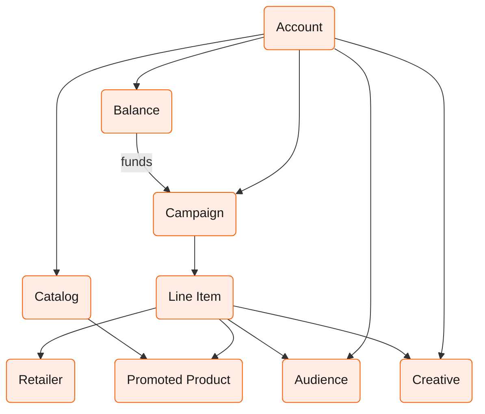

The Retail Media API is organized around a small set of objects. Use this page to understand how they fit together before reading the individual concept pages.

## Campaign hierarchy

| Object | Role |
|---|---|
| **Account** | Top-level entity. All campaigns, balances, catalogs, audiences, and creatives belong to an account. |
| **Campaign** | Groups line items under a shared marketing objective and attribution window. Does not deliver ads directly. |
| **Balance** | Budget pool that funds one or more campaigns. When exhausted, all linked campaigns stop. |
| **Line Item** | Delivery unit. Targets one retailer, holds promoted products, controls bid, budget, and targeting. |

## Content and targeting

| Object | Role |
|---|---|
| **Promoted Product** | A product from the catalog assigned to a line item. Up to 500 per line item. |
| **Catalog** | Daily snapshot of the account's eligible products per retailer. Source for selecting promoted products. |
| **Audience** | Named set of users built from behavioral segments. Created at account level, applied to Onsite Display line items. |
| **Creative** | Display ad built from a retailer template. Created at account level, applied to Onsite Display line items. |
| **Retailer** | The retail platform where ads are served. Each line item targets exactly one retailer. |

<Info>
  Audience and Creative are used by **Onsite Display** line items. **Sponsored Products** line items use keyword targeting instead — see [Onsite Sponsored Products](/retail-media/docs/onsite-sponsored-products).
</Info>
