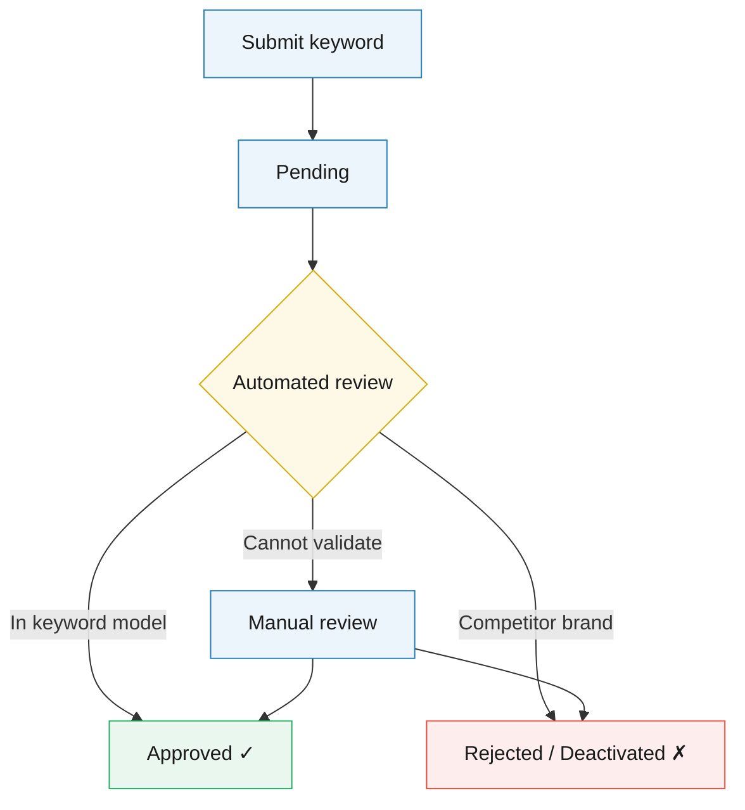

Onsite Sponsored Products (SP) is a CPC auction format. Ads appear in retailer search results and category pages, alongside organic product listings. The advertiser bids on keywords; the retailer's auction determines which ads show and in what order.

SP campaigns use the `SponsoredProducts` campaign type. Each line item targets one retailer and promotes one or more products from your catalog.

**How it differs from Onsite Display:** SP targets shoppers by keyword and runs on a CPC auction. Onsite Display targets shoppers by audience, store, or add-to-basket behavior and runs on preferred deals (fixed CPM).

<Note>
  See the full list of endpoints and parameters in the [→ API Reference](/retail-media/reference/get-auction-line-items-by-campaign)
</Note>

<Note>
  Learn more in the [CMax Help Center](https://help.retailmedia.criteo.com/kb/en/create-and-edit-onsite-sponsored-products-campaigns-and-line-items-127257)
</Note>

---

## Keywords

Keywords are the targeting mechanism for SP line items. You specify which search terms should trigger your ads (positive keywords) and which should suppress them (negative keywords).

### Positive keywords

Submitted (positive) keywords target shoppers based on exact-match search phrases. The API uses `PositiveExactMatch` — the shopper's search term is normalized and compared to your keyword.

| Match type | Keyword | Ads show for |
|---|---|---|
| `PositiveExactMatch` | Women's shoes | Women's shoes, Womens shoes, Womens shoe |

**Keyword normalization** strips stop words, stems remaining words, and sorts them alphabetically before matching. "Runner" becomes "run"; "the" is removed.

### Negative keywords

Negative keywords suppress ads on searches you want to exclude. Two match types are available:

| Match type | Keyword | Ads won't show for | Ads may show for |
|---|---|---|---|
| `NegativeBroadMatch` | Men's shoes | Men shoes, Blue men's shoes, Men's shoe size 9 | Shoes, Boy's shoes |
| `NegativeExactMatch` | Men's shoes | Men's shoes, Mens shoes, Mens shoe | Shoes, Blue men's shoes |

Negative keywords affect search placements only — they do not suppress ads on non-search pages.

### Keyword approval workflow

Submitted keywords enter a review queue before taking effect:

- If the keyword is already in Criteo's keyword model, it is auto-approved.
- If it contains a competitor brand name, it is rejected and deactivated.
- Otherwise it goes to manual review.

Keyword bids only take effect once a keyword is approved. Bids on in-review or rejected keywords have no effect.

### Keyword bidding

You can set individual CPC bids per keyword for more granular spend control.

- Keyword bids must be at or above the line item's minimum CPC bid.
- If the line item has a maximum CPC bid set, it is always enforced — even if a keyword bid exceeds it.

---

## Constraints

- Each line item targets **one retailer** only. Create separate line items to advertise across multiple retailers.
- Each line item supports up to **500 promoted products**.
- Keyword bids must respect the line item's **minimum CPC bid**.
- Submitted keywords must pass the approval workflow before they can serve.
- Negative keywords suppress ads on matching search queries but do not affect non-search placements.
- Campaigns are limited to **10,000 non-archived line items**. Line items are archived automatically 90 days after their end date.
