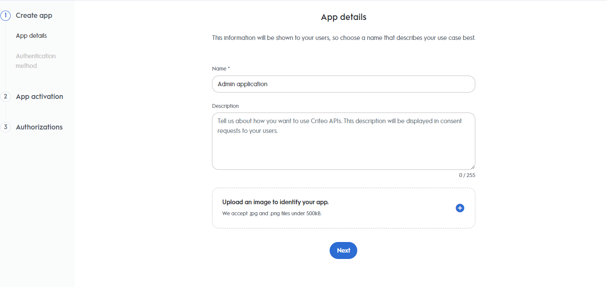
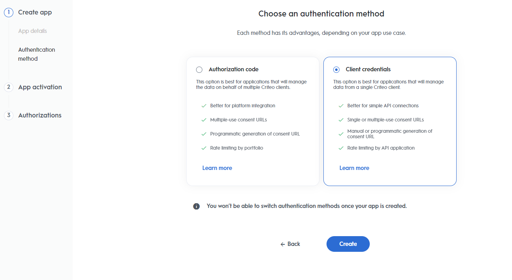
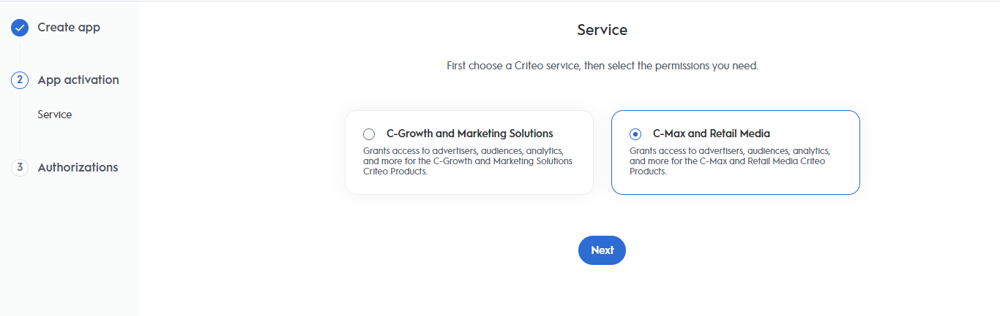
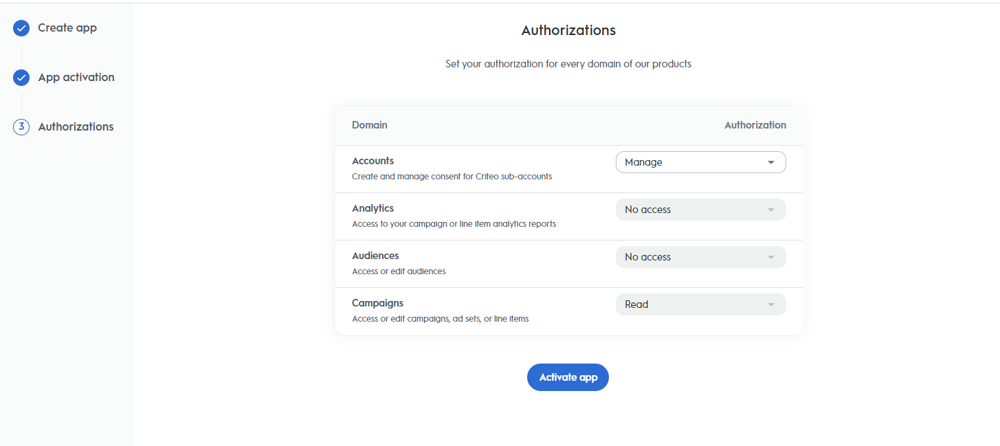
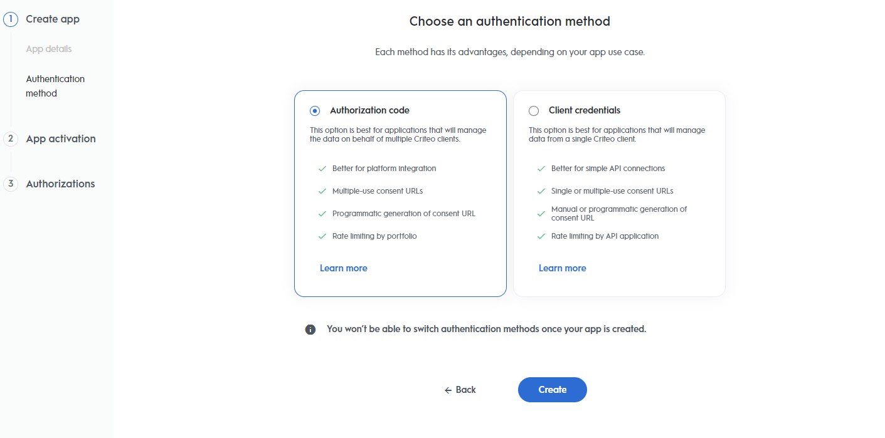
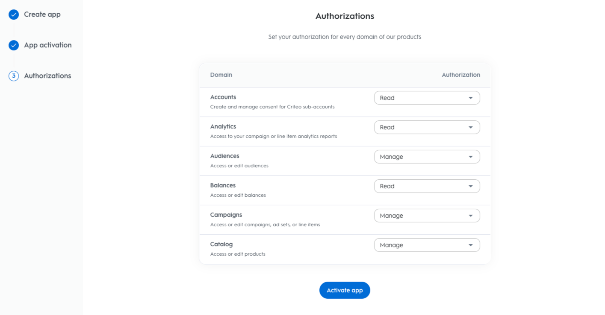
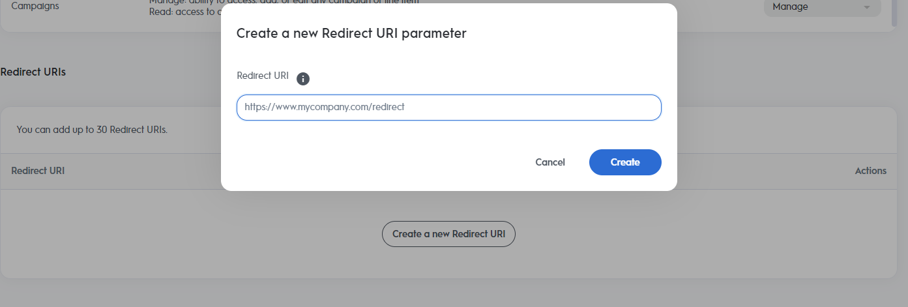

Programmatic consent granting for private market uses two separate API applications — an Admin app for account creation and consent management, and a Business app for all API operations on behalf of demand accounts. By the end of this guide, your Business app will have an access token linked to a specific demand account.

**Use this guide if you** are a private market retailer building a programmatic integration where consent is granted without requiring each demand account user to log into the Criteo portal.

## Prerequisites

- Access to the Criteo partner portal ([partners.criteo.com](https://partners.criteo.com))
- Two app registrations: one Admin app (client credentials) and one Business app (authorization code)
- Admin role, Business Manager role, or Technical Manager role on the retailer account

---

## Steps

### 1. Create the Admin app

Log into [partners.criteo.com](https://partners.criteo.com/dashboard/442/apps) and create a new app.

<Frame>
  
</Frame>

Select **Client Credentials** as the authentication method.

<Frame>
  
</Frame>

Select **C-Max and Retail Media** as the application service.

<Frame>
  
</Frame>

Select the **Accounts** domain only, with **Manage** access.

<Frame>
  
</Frame>

<Info>
  When selecting the Accounts domain you will see the message: **Applications that select "Manage Accounts" will also be granted Campaign Read permissions.** This is expected — click "Got it".
</Info>

Click **Activate App**, then in App credentials click **Create new key** to download your credentials. Store them securely.

---

### 2. Create the Business app

Create a second app in the portal.

<Frame>
  
</Frame>

Select **Authorization Code** as the authentication method.

<Frame>
  
</Frame>

Select **C-Max and Retail Media** as the application service. Select all relevant authorization domains (Analytics, Audience, Campaigns, Catalog) — do not select **Accounts**, which is exclusively managed by the Admin app.

<Frame>
  
</Frame>

Click **Activate App** and create credentials. In the Redirect URI section, register the `callbackUrl` where Criteo will send your authorization code.

<Frame>
  
</Frame>

---

### 3. Authenticate the Admin app

Generate a token for your Admin app using its client credentials.

```bash
curl -X POST "https://api.criteo.com/oauth2/token" \
  -d 'grant_type=client_credentials' \
  -d 'client_id={ADMIN_CLIENT_ID}' \
  -d 'client_secret={ADMIN_CLIENT_SECRET}'
```

**Response:**

```json
{
    "access_token": "<TOKEN STRING>",
    "token_type": "Bearer",
    "expires_in": 900
}
```

---

### 4. Grant account consent

Using the Admin app token from step 3, call the consent grant endpoint. The `demandAccountId` is the ID of the demand account you are granting access to.

```bash
curl -X POST "https://api.criteo.com/{version}/retail-media/accounts/{demandAccountId}/grant-consent" \
  -H "Content-Type: application/json" \
  -H "Authorization: Bearer <ADMIN_ACCESS_TOKEN>" \
  -d '{
    "data": {
      "type": "GrantConsentModel",
      "attributes": {
        "clientId": "{BUSINESS_APP_CLIENT_ID}",
        "callbackUrl": "{BUSINESS_APP_CALLBACK_URL}",
        "callbackState": "{DEMAND_ACCOUNT_ID}"
      }
    }
  }'
```

- `clientId` — your Business app client ID from step 2
- `callbackUrl` — the redirect URI registered in step 2
- `callbackState` — optional, but recommended: pass the demand account ID so you can associate it with the right token when the callback fires

A successful request returns `HTTP 204 No Content`.

---

### 5. Exchange the authorization code for an access token

As soon as step 4 completes, your `callbackUrl` receives a `code` query parameter. Exchange it for an access and refresh token pair using the Business app credentials.

```bash
curl -X POST "https://api.criteo.com/oauth2/token" \
  -d 'grant_type=authorization_code' \
  -d 'client_id={BUSINESS_APP_CLIENT_ID}' \
  -d 'client_secret={BUSINESS_APP_CLIENT_SECRET}' \
  -d 'code={CODE}' \
  -d 'redirect_uri={BUSINESS_APP_CALLBACK_URL}'
```

The Business app can now make API calls to all domains (Analytics, Audience, Campaigns, Catalog) on behalf of the demand account.

---

## Verify

A successful consent grant (step 4) returns `HTTP 204`. A successful token exchange (step 5) returns a JSON body containing `access_token` and `refresh_token`. Use the `access_token` as a Bearer token in subsequent Business app API calls.

---

## Refreshing access tokens

To renew an access token using a refresh token:

```bash
curl -X POST "https://api.criteo.com/oauth2/token" \
  -H "Content-Type: application/x-www-form-urlencoded" \
  -d "grant_type=refresh_token&refresh_token={REFRESH_TOKEN}&client_id={CLIENT_ID}&client_secret={CLIENT_SECRET}"
```

| Parameter | Description |
|---|---|
| `grant_type=refresh_token` | Indicates you are providing a refresh token |
| `refresh_token` | Refresh token received during the token exchange in step 5 |
| `client_id` | Your Business app public key from the credentials section |
| `client_secret` | Your Business app secret key |

The response has the same shape as a fresh access token response.
